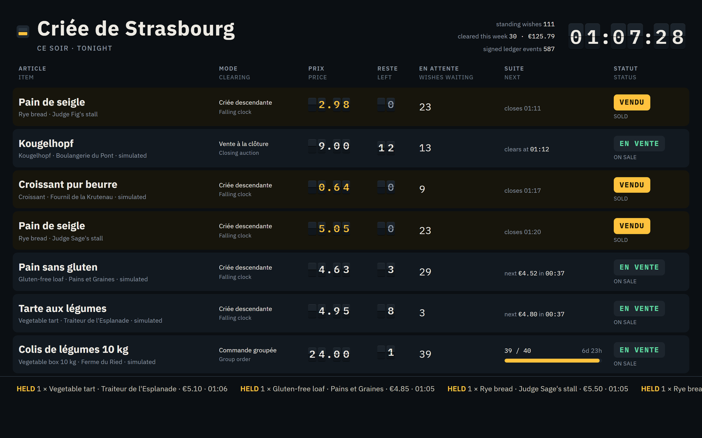
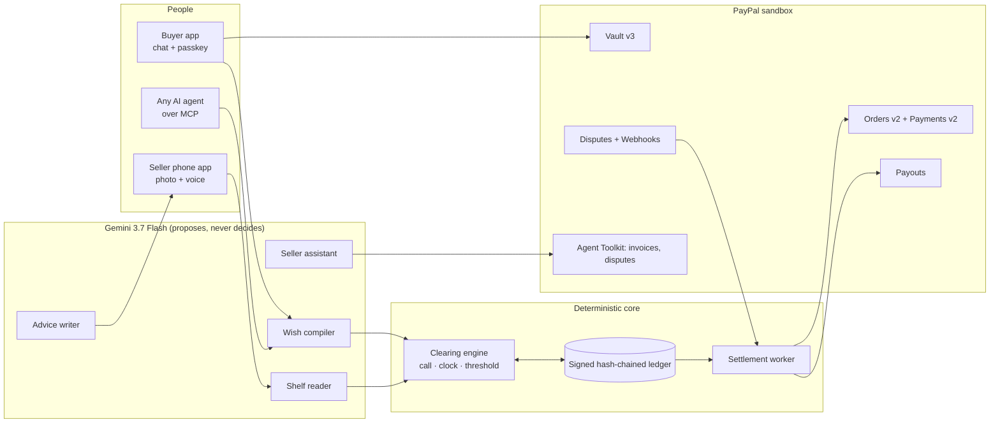
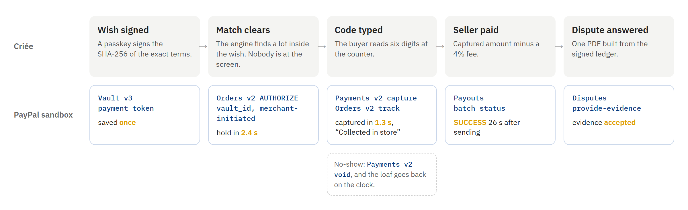
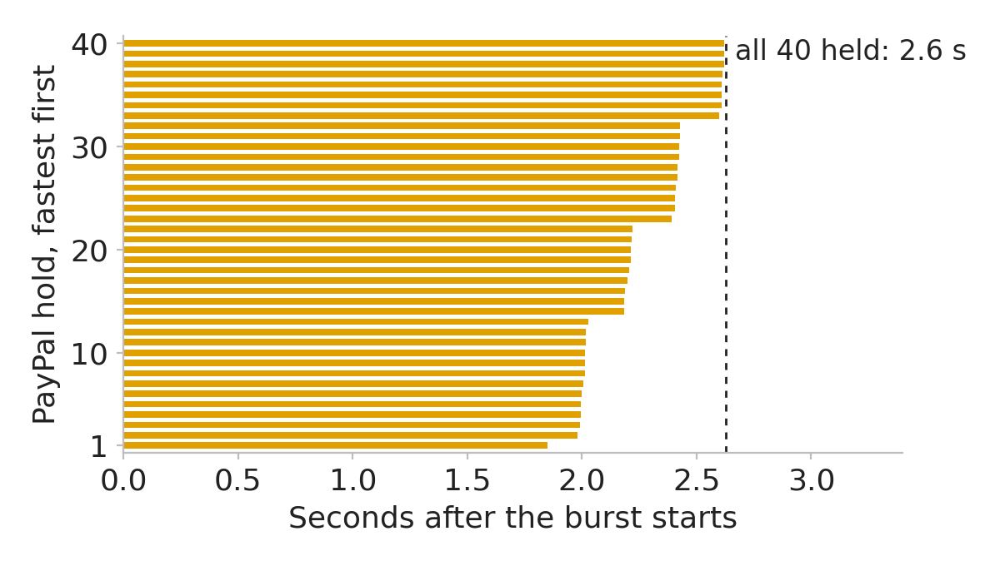

# Criée

**Criée is a clearing house for what small food sellers have left at closing.** People, or their own AI agents, leave standing wishes such as "an organic sourdough loaf twice a week, under €5, after six". Each wish is signed once with a passkey. At closing, a baker photographs the shelf and Criée lists what is left. A deterministic engine clears the two like a market, and PayPal settles each match the moment it clears. PayPal takes a hold on the buyer's saved wallet, captures it when the pickup code is scanned, and pays the seller through Payouts within the minute.

Built for *Build What's Next with PayPal and AI*. Everything below runs on the PayPal sandbox.



| | |
|---|---|
| Hosted demo | https://marc-dvci.github.io/Criee/ (redirects to the live instance) |
| Video (2:30) | https://youtu.be/-QVhwYTAiZY |
| One click to try | **Play both sides** on the home page: you become a buyer with a demo PayPal wallet and a seller with a stall |
| Local run | `docker compose up`, then http://localhost:8000. Runs with or without keys |
| Measured on the hosted instance | 40 PayPal holds taken in **2.7 s** when a group order fills · one buyer-absent hold in **2.1 s** |

## Try it in two minutes

1. Open the hosted demo and click **Play both sides**. Your account gets a demo PayPal wallet that is already saved, a stall on Place Kléber, and an open market of simulated bakeries, a traiteur and a farm's group order. Simulated actors are labelled on every screen. Their matches settle through the same PayPal sandbox path as yours.
2. **Wish.** Type *A 10 kg vegetable box from a local farm, up to €28*. Read the sentence back, then sign it with your passkey or with this browser's key. The farm's group order stands at 39 of 40. Your wish completes it, and Criée takes 40 PayPal holds in one burst and captures them. The board shows the burst time.
3. **Sell.** On the Sell page, photograph any food with a price sign or label, or upload `data/samples/test_shelf.jpg`. Gemini lists the items and keeps a fact only when it can point to the label crop it read it from. Start a falling clock. Wish for that item from the Wish page, and watch your own wish buy it.
4. **Collect.** Type the six-digit pickup code from the Wish page into the seller's keypad. The hold is captured, the pickup is attached to the PayPal order as tracking, and the payout to the seller appears in the console.
5. **Check.** The Console shows every sale with its PayPal authorization and capture, refunds, payouts, disputes and the anonymised order book. The Ledger page verifies the whole signed hash chain in one click.

To save a real sandbox PayPal instead of the demo wallet, click **Save my PayPal (sandbox)** and log in with any sandbox personal account.

## How it works



**A wish is a limit order.** It names a category, conditions such as organic or gluten-free, a price ceiling, units, a weekly cap and budget, a pickup area and hours, the clearing modes it accepts, and an expiry. The person signs the SHA-256 of its canonical JSON with a passkey (WebAuthn, the digest is the challenge), so the stored assertion proves consent to those exact terms.

**A lot is the supply.** It carries a quantity, a start price and a floor, a deadline and a pickup window, and typed facts. A fact is known only when it carries evidence: an image crop of the printed label, the seller's own words in the transcript, or the seller's explicit confirmation. Anything else is stored as unknown, and an unknown fact never satisfies a buyer's condition.

**Three clearing rules.**

| Rule | How the price is set | Who wins |
|---|---|---|
| Closing auction | One uniform price at the deadline: the higher of the floor and the highest losing limit | The highest limits. For one-unit wishes, stating your true limit is the best strategy |
| Falling clock | The price steps down from the start to the floor and reaches the floor at 80% of the window | At each tick, every eligible wish whose limit covers the price, highest limit first, ties by a seeded lottery |
| Group order | One fixed price, only if the target quantity is committed by the deadline | Short windows (3 days or less) hold at commitment. Longer windows take every hold in one burst at quorum, and a waitlist replaces any refused hold |

Each lot commits to the SHA-256 of a random seed when it is listed and reveals the seed when it closes, so every lottery can be replayed.

**The model proposes, code decides.** Gemini reads words, shelves and voice notes. The engine reads only enums, integers, coordinates, timestamps and identifiers. A test walks the engine's input schemas and fails on any free-text field, so no seller- or buyer-written text can reach the clearing logic.

## Technological implementation

### PayPal, end to end

Criée is the merchant of record. Every call below runs against the sandbox in the hosted demo. `criee/settlement/paypal.py` is the typed client, and `criee/settlement/worker.py` drives it.

| Step | PayPal API | Where |
|---|---|---|
| Save the buyer's PayPal once | `POST /v3/vault/setup-tokens`, buyer approval, `POST /v3/vault/payment-tokens` | `paypal.py` `setup_token`, `payment_token`; route `/api/vault/*` |
| Hold when a match clears, buyer absent | `POST /v2/checkout/orders` with `intent: AUTHORIZE`, `payment_source.paypal.vault_id` and `stored_credential` (merchant-initiated, unscheduled) | `authorize_vaulted` |
| Take the money at the counter | `POST /v2/payments/authorizations/{id}/capture` with `final_capture` | `capture` |
| Release a no-show or a failed group order | `POST /v2/payments/authorizations/{id}/void` | `void` |
| Record the pickup on the order | `POST /v2/checkout/orders/{id}/track`, carrier `OTHER`, "Collected in store" | `track` |
| Refund a missing item | `POST /v2/payments/captures/{id}/refund`, partial amounts | `refund` |
| Pay the seller | `POST /v1/payments/payouts`, then batch status | `payout`, `get_payout` |
| Answer "my agent did it" | `GET /v1/customer/disputes`, `POST .../provide-evidence` with a PDF built from the ledger | `api/disputes.py` |
| Stay in sync | `POST /v1/notifications/webhooks`, `verify-webhook-signature`, de-duplication by event id | `api/webhooks.py` |
| Seller assistant | PayPal Agent Toolkit (`paypal-agent-toolkit`): `list_disputes`, `get_dispute`, `create_invoice`, `send_invoice`, `generate_invoice_qr_code`, `list_invoices`, `get_invoice` | `ai/assistant.py` |



*One sale, end to end, as recorded on the ledger, with the times measured on the sandbox. `scripts/settlement_figures.py` draws it from `data/settlement_timings.json`.*



*The 40 PayPal holds of one group order, taken concurrently on the sandbox: all 40 held 2.6 s after the burst started. The same calls made one after another add up to 91 s.*

Every mutating call carries a `PayPal-Request-Id` derived from the match it settles, so a retry returns the original result instead of charging twice. The seller's payout is the captured amount minus a 4% platform fee, minus any refund made after an earlier payout.

### AI

| Component | Model work | Guardrail in code |
|---|---|---|
| Wish compiler (`ai/wish.py`) | Gemini fills a fixed JSON schema from the person's words, in French or English | Code converts and bounds the draft. The read-back sentence is rendered from the typed terms by a template, so the person approves exactly what they sign. A missing price becomes a question |
| Shelf reader (`ai/supply.py`) | Gemini reads one to four photos and a voice note: items, counts, prices, label facts with `box_2d` boxes, transcript | A label fact is kept only with its box, which becomes a stored crop. A spoken fact is kept only if its quote appears in the transcript. The seller confirms each lot |
| Demand advice (`ai/advisor.py`) | Gemini writes one or two sentences | Every figure is computed from the order book. `numbers_ok` rejects a sentence containing any number outside the computed set. No curve is shown below five distinct buyers |
| Seller assistant (`ai/assistant.py`) | Gemini function calling over the Agent Toolkit tools and Criée's seller-scoped tools, with thought signatures echoed back | Refunds are prepared by the assistant and executed only when the seller taps Confirm. Invoice QR codes go to the screen, never back to the model |
| Agents (`mcp_server.py`) | Any MCP client: `create_wish`, `list_wishes`, `pause_wish`, `resume_wish`, `revoke_wish`, `list_matches`, `market_now` | `create_wish` returns a signing link. An agent can never sign a wish |

Model access is server-side only. Live calls stop after a configured date, past a daily call cap, past a daily dollar budget and past a per-visitor hourly allowance. Each call reserves the most it could cost before it is sent and settles to its billed tokens after, so the dollar budget holds even under concurrent calls. The demo inputs are recorded in `data/ai_recordings`, and every component has a deterministic fallback. The whole product therefore runs with no key at all.

### The engine and its invariants

`criee/engine.py` is a pure fold over ledger events plus a decision function that processes one logical moment at a time. Results depend only on the events and the seeds, never on when or how often the scheduler wakes. Property tests in `tests/test_invariants.py` generate random markets, revocations, refused holds, pickups and scheduler wake-up patterns, and check that:

1. units matched never exceed units offered;
2. every match lies inside its signed wish: price, conditions, distance, hours, weekly count and budget;
3. every hold ends captured or voided;
4. waking the scheduler at different times gives the same matches, and replaying the ledger reproduces the state;
5. a webhook delivered twice changes nothing (`tests/test_api.py`);
6. no free-text field reaches the engine;
7. a revoked wish never matches after its revocation.

The ledger (`criee/ledger.py`) is append-only SQLite with triggers that refuse updates and deletes. Each event commits to the previous event's hash and carries an Ed25519 signature, and `/api/ledger/verify` re-checks the whole chain.

`pytest` runs 58 tests: engine rules, invariants, settlement against an in-memory PayPal double, the HTTP API including MCP and signatures, the evidence PDF, the AI guardrails and the simulation.

## Design

Three surfaces share one design language: the fish-auction hall and the station departures board. Dark slate, chalk white, and one amber signal for "sold".

- **Buyer** (`/wish`): describe a wish, read it back, sign. Each wish shows its weekly use, what it is watching and why open lots did not match ("a fact you asked for is not shown on the label"), group-order commitments with their progress, and pickup codes.
- **Seller**, built phone-first (`/sell`): photograph the shelf, see each item boxed on the photo with the label crops behind its facts, pick a clearing mode, watch the split-flap price, type pickup codes on a keypad, read the demand curve, and talk to the assistant.
- **Board** (`/board`): the city's leftovers as a departures board, with headers in French and English, live prices, wishes waiting, group-order progress and burst timing. Price changes are announced to screen readers through a polite live region.
- **Console** (`/console`): AG Grid tables for sales with PayPal ids, payouts, disputes and the anonymised order book, and an AG Charts demand curve.
- **Ledger** (`/ledger`): every event with its hash, and chain verification in one click.

## Potential impact

Households, food service and retail wasted 1.05 billion tonnes of food in 2022, about a fifth of the food available to consumers ([UNEP Food Waste Index Report 2024](https://www.unep.org/resources/publication/food-waste-index-report-2024)). An independent bakery ends most days with unsold loaves. Selling them depends on someone happening to walk past at closing, or opening an app at the right moment. A standing wish removes that dependence: the buyer is present at every closing without being there.

I simulated a week of 12 bakeries and 10,000 residents in Strasbourg, with 20 seeds per policy. The Criée policy runs through the real engine. All figures below are **simulated**, and `docs/SIMULATION.md` lists every assumption.


| Per bakery-evening, 3% of residents hold a bread wish | Fixed markdown at 18:30 | Criée falling clock |
|---|---|---|
| Loaves wasted | 6.81 ± 0.76 | **3.96 ± 0.64** |
| Seller revenue after fees | €15.27 ± 0.49 | **€26.75 ± 0.73** |
| Wish-holders served at least once in the week | 79% | **99.8%** |

Standing wishes are present at every closing, while a markdown depends on passers-by. When every resident is assumed to see every markdown (attention parity), Criée still clears more at a higher seller revenue: 4.06 against 4.42 loaves wasted, and €27.05 against €20.86. The remaining gap comes from price discovery: the clock sells each loaf near its buyer's limit.

## Innovation

- **An intent mandate is a limit order.** Agent payment protocols describe what a person allows an agent to buy. Criée treats each mandate as a standing order and clears many of them at once against perishable supply, with auction rules chosen for that case.
- **A PayPal hold as an assurance contract.** A group order goes ahead only if enough people commit. Holds are taken at quorum in one burst and voided if it fails, so nobody pays for a box that never ships.
- **Evidence-grounded listings.** A fact about food is a crop of its label or the seller's own words, never a guess about appearance.
- **Disputes answered from the ledger.** "My agent did it" meets the signed mandate, the clearing round, the pickup scan and PayPal's own tracking record, bundled as a PDF and sent through the Disputes API.

## Claims and where to check them

| Claim | Code | Test or evidence |
|---|---|---|
| Wishes are signed over their exact terms | `api/auth.py`, `web/src/signing.ts` | `test_api.py::test_wish_is_signed_over_its_exact_terms` |
| The clearing rules behave as stated | `engine.py` | `test_engine.py` |
| Matches stay inside signed wishes, replays are exact | `engine.py` | `test_invariants.py` |
| Buyer-absent hold, capture, tracking, payout | `settlement/worker.py`, `settlement/paypal.py` | `test_settlement.py`; `scripts/live_check.py` against the sandbox |
| 40 holds in one burst | `settlement/worker.py::_burst` | `burst.measured` events on the ledger; `scripts/judge_burst.py` |
| Agents cannot sign | `mcp_server.py` | `test_api.py::test_agent_drafts_but_cannot_sign` |
| Facts need evidence | `ai/supply.py` | `test_ai.py::test_shelf_facts_without_evidence_are_unknown` |
| Advice numbers are checked | `ai/advisor.py` | `test_ai.py::test_advice_checker_rejects_invented_numbers` |
| The model key stays on the server, and spending stops at the cap | `ai/provider.py` | `test_api.py::test_ai_key_never_leaves_the_server`, `test_ai.py::test_budget_refuses_after_cutoff_and_over_caps` |
| Simulation figures | `sim.py` | `test_sim.py`, `data/sim/results.json` |

## Run it locally

```bash
cp .env.example .env          # optional: PayPal sandbox app keys, a Gemini API key
docker compose up --build     # http://localhost:8000
```

Without PayPal keys, Criée settles on an in-memory PayPal double with the same interface. Without a model key, it replays `data/ai_recordings` and uses its deterministic paths.

For development:

```bash
uv venv --python 3.12 && uv pip install -e ".[dev]"
uvicorn criee.api.app:create_app --factory --reload      # API on :8000
cd web && npm ci && npm run dev                             # UI on :5173, proxied to the API
pytest                                                      # 58 tests
python -m criee.sim --seeds 20 --out data/sim/results.json  # simulation
```

The hosted instance runs the same image on AWS (Amazon Linux 2023, Graviton) behind a Cloudflare tunnel; `deploy/` holds the instance setup and the deploy script.

## What I built during the hackathon

All of it, between 1 October and 12 November 2026: the sandbox probe, the clearing engine and ledger, PayPal settlement, the AI components, the MCP server, the web app, the simulation and the deployment.

## Tools

PayPal REST APIs (Vault v3, Orders v2, Payments v2, Payouts, Customer Disputes, Webhooks) and the PayPal Agent Toolkit for Python · Gemini 3.7 Flash (Gemini API) · AG Grid and AG Charts (Community) · FastAPI, Pydantic, SQLite · React, Vite, TypeScript · py_webauthn and WebAuthn · Model Context Protocol Python SDK · ReportLab · Hypothesis and pytest · Playwright · AWS EC2 · Cloudflare Tunnel.

## License

Apache-2.0. See [LICENSE](LICENSE).
