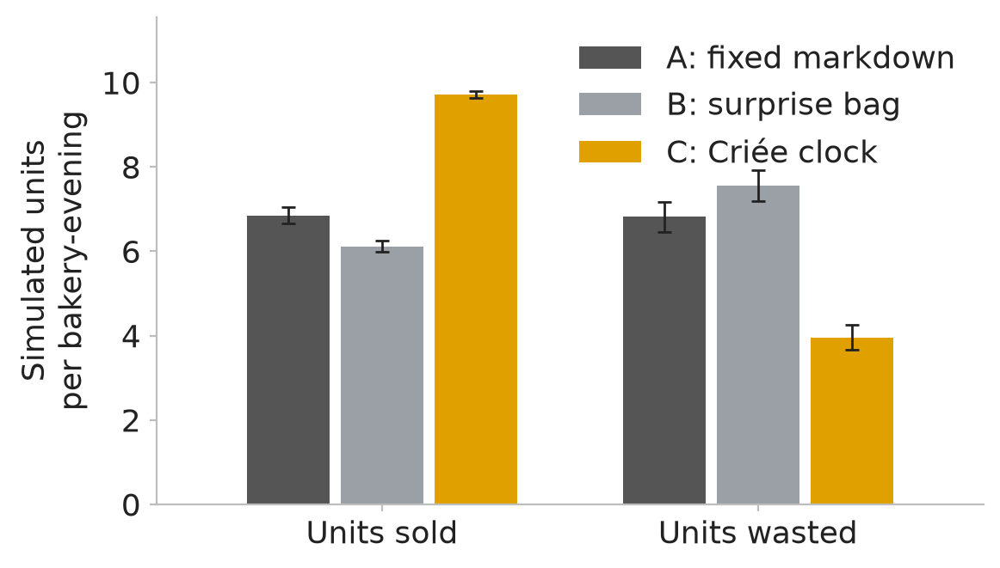
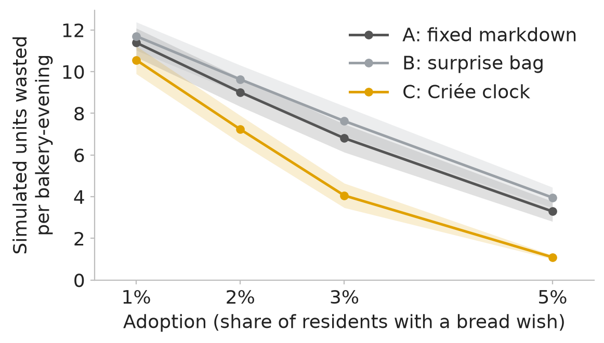

# Simulated comparison of three end-of-day policies

This document describes a simulation. Every number in it is simulated. It is not a forecast, a pilot, or a measurement of real bakeries or real buyers. It compares three ways a bakery can clear its unsold bread at the end of the day, over one simulated week in Strasbourg.

## The three policies

- **A: fixed markdown.** From 18:30 the bakery sells every leftover loaf at half its list price.
- **B: surprise bag.** The bakery packs leftovers into bags of three loaves, sold at one list price per bag through an app. Leftovers that do not fill a bag are wasted.
- **C: Criée clock.** From 18:30 the bakery lists a descending clock. The price starts at list price, reaches 30% of list at about 19:02, and holds there until the clock closes at 19:10. A buyer takes one loaf at the first tick where the price is at or below their limit, while loaves remain. Pickup runs from 18:30 to 20:30.

## Method

- **Week and places.** The simulated week runs from Monday 19 to Sunday 25 October 2026, Europe/Paris, with seven evenings. There are 12 bakeries. Each sits at a random point within 600 m of one of the 11 neighbourhood centroids in `criee/demo.py`, cycling through the list, so two neighbourhoods get two bakeries.
- **Residents and holders.** 10,000 residents are placed by neighbourhood weight. A share equal to the adoption rate holds a standing bread wish. The adopters are the lowest-ranked residents of one random ranking, so the 1% group sits inside the 2% group, and so on. For each seed, all three policies run on the same world: the same bakeries, supply, holders, limits, radii and weekly allowances.
- **Policy C uses the real engine.** Policy C runs through `criee.engine` (`Market` and `run_until`) on an in-memory signed ledger, with the real `WishTerms` and `LotTerms`. The engine is not changed. Policies A and B are plain rules in `criee/sim.py`. They measure distance with the engine's `haversine_m`, so every policy uses the same distance rule.
- **Three additions around the engine for C.** The brief rules out some behaviour that the engine, used as is, would allow or produce. I handle it in three ways, and each one appears in the assumptions table.
  1. *One loaf per resident per evening.* The engine has no per-evening cap. After a match, the holder's wish is paused with the engine's own pause event and resumed the next morning. A holder whose weekly allowance is used up stays paused.
  2. *Lots close at sell-out.* Without this, the engine keeps emitting empty clock ticks until 19:10. No fill can happen after sell-out. Allocations were checked to be identical to the unshortened code on four seed and adoption pairs, with this shortcut in place.
  3. *No-shows.* 8% of matches are no-shows, chosen by a hash of the seed and the match id. A no-show's loaf is never returned to the clock and earns nothing, and the buyer's match still uses up the allowance. The engine's own no-show path would return the loaf to the clock, so the simulation does not use that path.
- **Weekly allowance.** Every policy counts loaves against each holder's weekly allowance of 2 to 4 loaves. A and C sell one loaf at a time. B sells bags of three, so a bag uses three loaves of the allowance, and a holder with fewer than three loaves left cannot buy a bag. In every policy a holder makes at most one purchase per evening.
- **Attention.** This is the mechanism the comparison measures. In C a standing wish is live every evening until the allowance is used up, and it is paused only after a match. In A a holder reaches a bakery only when a passer-by draw succeeds, at 10% per bakery in radius per evening. In B a holder acts only when an app-open draw succeeds, at 25% per evening. The attention-parity run sets both of those draws to 1.0, so every holder in radius considers every shop every evening. C is unchanged in that run.
- **Costs.** Leftovers are sunk cost. The unit cost of 35% of list is recorded in `assumptions.json` for reference only, and no decision or metric uses it. The clock floor is 30% of list in every run.
- **Metric definitions.** "Per bakery-evening" means the week total divided by 84 (12 bakeries times 7 evenings). Seller net revenue is gross revenue minus the 4% platform fee for C, and equals gross for A and B. Mean price paid is revenue divided by loaves sold. Mean buyer surplus is the sum of (limit minus price paid) over loaves sold, divided by loaves sold. For a bag, each of its three loaves counts at its limit minus one third of the bag price. A holder counts as served if they completed at least one purchase in the week. A no-show does not count.
- **Statistics.** The sd is the sample standard deviation over seeds. The 95% interval is the Student-t interval of the mean across seeds, used for the figure whiskers and bands. The drop-one range is the lowest and highest value of the mean when each seed in turn is left out.
- **Seeds.** The headline uses seeds 0 to 19 at 3% adoption. The sensitivity uses seeds 0 to 9 at each adoption rate, so its 3% row is the headline's seeds 0 to 9. The attention-parity run uses seeds 0 to 9 at 3% adoption.

## Assumptions

"Brief" marks a value given in the brief. "Added" marks a choice I made where the brief was silent or where a rule had to be written down to run.

| Assumption | Value | Source | Rationale |
|---|---|---|---|
| Week | Mon 19 to Sun 25 Oct 2026, Europe/Paris, 7 evenings | Added | An ordinary week with no public holiday. |
| Bakeries | 12, one per cycle through the 11 neighbourhood centroids | Brief | Two neighbourhoods get two shops. |
| Bakery placement | Uniform within 600 m of the centroid | Brief | Keeps each shop in its neighbourhood. |
| List price | Uniform EUR 3.50 to 5.50 per loaf, one draw per bakery | Brief | The spread of loaf prices given in the brief. |
| Unit cost | 0.35 x list price | Brief | Reported for reference only. Leftovers are sunk cost, so no decision and no metric uses it. |
| Clock floor | 0.30 x list price, in every run | Brief | Set by the brief, not by unit cost, because leftovers are sunk cost. |
| Leftover supply | Poisson(lambda) per bakery per evening, lambda uniform 8 to 20 | Brief | Leftovers vary by bakery and by evening. |
| Residents | 10,000, placed by neighbourhood weight with jitter of 0.004 deg lat and 0.006 deg lon | Brief | Only holders buy in the model, so only holders affect results. |
| Adoption, headline | 3% (300 holders) | Brief | The default in the brief. |
| Adoption, sensitivity | 1%, 2%, 3%, 5%, with nested holder sets | Brief | The sensitivity grid. Nesting keeps the comparison paired. |
| Holder limit | Uniform 0.35 to 0.95 x EUR 4.50, rounded to cents (EUR 1.58 to 4.28) | Brief | The range given in the brief. |
| Holder radius | 1,500 m (50%), 2,500 m (35%), 4,000 m (15%) | Brief | The mix given in the brief. |
| Holder weekly allowance | Uniform integer 2 to 4 loaves per week | Brief | The brief's max_matches_per_week, read as a loaf allowance on the same basis in all three policies. |
| Holder units | 1 loaf per match in A and C; 3 loaves per bag in B | Brief | One loaf per standing wish; one bag per purchase in B. |
| Holder window | Every day 17:00 to 21:00 | Brief | Covers the 18:30 to 20:30 pickup window. |
| Holder budget | Limit x allowance per week | Added | Set so the budget can never bind before the allowance does. |
| Distance rule | Engine's `haversine_m` for all policies | Added | One distance rule for every policy. |
| A price | 0.50 x list price from 18:30, every loaf | Brief | A fixed markdown. |
| A walk-by | 0.10 per holder, per bakery in radius, per evening | Brief | Stands in for passers-by who would buy. Attention is the mechanism the comparison measures. |
| A arrival order | Random within 18:30 to 20:30; earlier arrivals take loaves first | Added | The brief does not order passers-by. |
| A one per evening | One loaf per holder per evening | Brief | Applies to A. |
| B bag | Three loaves at one list price per bag | Brief | One third of the three-loaf value. |
| B open rate | 0.25 per holder per evening | Brief | The chance a holder opens the bag app on a given evening. |
| B allowance | A bag uses 3 of the weekly loaves; a holder with fewer than 3 left cannot buy a bag | Added | Puts the cap on the same loaf basis as A and C. A holder whose allowance is 2 never buys a bag. |
| B one per evening | One bag per holder per evening | Added | Matches the one-purchase rule in A and C. |
| B bakery choice | Nearest bakery in radius with bags left and price within the limit | Added | The brief does not say which bakery a buyer picks. |
| B buyer order | Random, first come first served | Added | The brief does not order buyers. |
| B commission | Not modelled | Brief | The brief leaves it out. This flatters B relative to C, whose fee is 4%. |
| C engine | `criee.engine` `Market` and `run_until`, in-memory signed ledger | Brief | The real engine, unchanged. Its weekly match cap counts matches, and each match is one loaf here. |
| C clock | Start at list price, open 18:30, close 19:10, one-minute ticks | Brief | The price reaches the floor at 80% of the window, about 19:02. |
| C pickup window | 18:30 to 20:30 | Brief | Pickup window of each clock lot. |
| C one loaf per evening | Wish paused after a match, resumed next morning; holders at their allowance stay paused | Added | The engine has no per-evening cap. |
| C sell-out close | Lot closes the moment it sells out | Added | Avoids empty ticks. Allocations checked unchanged on four pairs. |
| C tie order | Listing order shuffled each evening | Added | The engine breaks same-minute ties by listing order. |
| C no-show rate | 8% of matches, chosen by hash of seed and match id | Brief | The rate given in the brief. |
| C no-show treatment | Captured then fully refunded at match time: unit not returned, allowance still used, zero revenue | Added | The conservative treatment the brief asks for. |
| C platform fee | 4% of gross revenue | Brief | Applied to C only. |
| Attention, headline | A walk-by 0.10; B app-open 0.25; C standing wish live every evening | Brief for A and B; Added for C | The main comparison, which measures attention as well as the clearing rule. |
| Attention, parity | A walk-by 1.0; B app-open 1.0; C unchanged; seeds 0 to 9 | Added | Gives A and B the same attention as C's standing wishes, to separate attention from the clearing rule. |
| Seeds | 0 to 19 headline; 0 to 9 for sensitivity and attention parity | Brief | As given. |
| Interval | Student-t 95% interval of the mean across seeds | Added | Used for the figure whiskers and bands. |
| Random streams | One per seed and policy, seeded from a string | Added | Changing one policy does not shift another. |

## Simulated results

### Headline: 3% adoption, 20 seeds

Each cell gives mean ± sd over 20 seeds, with the drop-one-seed range of the mean in brackets. All values are simulated.

| Metric | A: fixed markdown | B: surprise bag | C: Criée clock |
|---|---|---|---|
| **Units wasted per bakery-evening** | 6.81 ± 0.76 (6.76 to 6.92) | 7.55 ± 0.79 (7.50 to 7.66) | 3.96 ± 0.64 (3.90 to 4.03) |
| **Units sold per bakery-evening** | 6.85 ± 0.40 (6.82 to 6.90) | 6.11 ± 0.29 (6.09 to 6.14) | 9.71 ± 0.18 (9.69 to 9.73) |
| **Seller net revenue per bakery-evening, EUR** | 15.27 ± 0.49 (15.23 to 15.32) | 9.23 ± 0.45 (9.18 to 9.27) | 26.75 ± 0.73 (26.69 to 26.85) |
| Seller gross revenue per bakery-evening, EUR | 15.27 ± 0.49 (15.23 to 15.32) | 9.23 ± 0.45 (9.18 to 9.27) | 27.86 ± 0.76 (27.80 to 27.97) |
| Mean price paid, EUR per loaf | 2.23 ± 0.10 (2.22 to 2.24) | 1.51 ± 0.06 (1.50 to 1.52) | 2.87 ± 0.05 (2.86 to 2.87) |
| Mean buyer surplus, EUR per loaf | 0.96 ± 0.06 (0.96 to 0.97) | 1.43 ± 0.08 (1.42 to 1.44) | 0.07 ± 0.01 (0.06 to 0.07) |
| Share of holders served at least once | 0.789 ± 0.043 (0.786 to 0.795) | 0.571 ± 0.027 (0.568 to 0.573) | 0.998 ± 0.002 (0.998 to 0.998) |

Units supplied are 13.67 ± 0.75 per bakery-evening in all three policies, because the supply draws are shared.

Standing wishes are always present in policy C. A holder's wish is live every evening, and it is paused only after a match, so C does not depend on a passer-by draw or an app-open draw. Policies A and B do depend on one: A on a passer-by probability of 10% per bakery in radius per evening, and B on an app-open probability of 25% per evening. This difference in attention is the mechanism the comparison measures, and the attention-parity run below removes it. In the headline run C wastes least, B wastes most and sells least, and C has the highest seller net revenue.

B's result comes mostly from the weekly allowance. A bag uses three of a holder's loaves, so a holder with an allowance of 3 or 4 buys at most one bag a week, and a holder with an allowance of 2 cannot buy one at all. On seeds 0 to 2, no holder bought more than one bag in a week, and no holder with an allowance of 2 bought any. Bags that nobody buys are wasted in full, and so is the remainder that does not fill a bag.

In C, buyers pay on average 0.07 EUR below their limit, so the clock takes almost all of the buyer surplus. C serves almost every holder at least once, while A serves 79% and B 57%.

### Attention parity: 3% adoption, seeds 0 to 9

Attention parity sets A's walk-by probability and B's app-open probability to 1.0, so every holder in radius considers every shop every evening. That is the attention C's standing wishes already have. C is unchanged, and for seeds 0 to 9 its figures are the same as in the headline run. Each cell gives mean ± sd over 10 seeds, with the drop-one-seed range in brackets. All values are simulated.

| Metric | A: fixed markdown | B: surprise bag | C: Criée clock |
|---|---|---|---|
| **Units wasted per bakery-evening** | 4.42 ± 0.83 (4.32 to 4.59) | 6.55 ± 0.99 (6.45 to 6.77) | 4.06 ± 0.82 (3.96 to 4.22) |
| **Units sold per bakery-evening** | 9.42 ± 0.26 (9.38 to 9.47) | 7.28 ± 0.20 (7.26 to 7.32) | 9.78 ± 0.12 (9.76 to 9.81) |
| **Seller net revenue per bakery-evening, EUR** | 20.86 ± 0.63 (20.77 to 20.97) | 10.93 ± 0.53 (10.85 to 11.03) | 27.05 ± 0.66 (26.95 to 27.15) |
| Seller gross revenue per bakery-evening, EUR | 20.86 ± 0.63 (20.77 to 20.97) | 10.93 ± 0.53 (10.85 to 11.03) | 28.17 ± 0.69 (28.07 to 28.28) |
| Mean price paid, EUR per loaf | 2.22 ± 0.08 (2.20 to 2.23) | 1.50 ± 0.05 (1.49 to 1.51) | 2.88 ± 0.06 (2.87 to 2.89) |
| Mean buyer surplus, EUR per loaf | 0.89 ± 0.06 (0.88 to 0.90) | 1.46 ± 0.08 (1.44 to 1.47) | 0.07 ± 0.02 (0.07 to 0.07) |
| Share of holders served at least once | 0.890 ± 0.025 (0.884 to 0.894) | 0.679 ± 0.018 (0.677 to 0.683) | 0.998 ± 0.002 (0.998 to 0.999) |

How much of each gap the parity run closes, as means over seeds 0 to 9:

| Gap | Headline run, seeds 0 to 9 | Attention parity | Share closed |
|---|---|---|---|
| Net revenue, C minus A (EUR per bakery-evening) | 11.56 | 6.19 | 46.5% |
| Net revenue, C minus B (EUR per bakery-evening) | 17.76 | 16.11 | 9.3% |
| Units wasted, A minus C | 2.75 | 0.36 | 86.9% |
| Units wasted, B minus C | 3.57 | 2.50 | 30.1% |

Equal attention removes most of C's waste lead over A (87%) and about half of its net-revenue lead (46.5%). The rest of the revenue lead is price. C's mean price is 2.88 EUR a loaf against 2.22 for A's fixed markdown, and the two sell almost the same number of loaves (9.78 for C and 9.42 for A). Equal attention does little for B (9.3% of the revenue gap), because B's shortfall comes from the weekly allowance, not from who is present.

### Sensitivity to adoption

Each cell gives mean ± sd over 10 seeds (seeds 0 to 9). All values are simulated.

**Units wasted per bakery-evening**

| Adoption | Holders | A: fixed markdown | B: surprise bag | C: Criée clock |
|---|---|---|---|---|
| 1% | 100 | 11.39 ± 0.97 | 11.70 ± 0.95 | 10.56 ± 0.93 |
| 2% | 200 | 9.01 ± 0.96 | 9.63 ± 0.95 | 7.23 ± 0.92 |
| 3% | 300 | 6.81 ± 0.94 | 7.63 ± 1.00 | 4.06 ± 0.82 |
| 5% | 500 | 3.29 ± 0.67 | 3.96 ± 0.69 | 1.10 ± 0.13 |

**Seller net revenue per bakery-evening, EUR**

| Adoption | Holders | A: fixed markdown | B: surprise bag | C: Criée clock |
|---|---|---|---|---|
| 1% | 100 | 5.38 ± 0.25 | 3.17 ± 0.23 | 9.05 ± 0.37 |
| 2% | 200 | 10.63 ± 0.29 | 6.30 ± 0.34 | 18.15 ± 0.55 |
| 3% | 300 | 15.49 ± 0.39 | 9.29 ± 0.45 | 27.05 ± 0.66 |
| 5% | 500 | 23.43 ± 0.90 | 14.81 ± 0.86 | 38.43 ± 2.12 |

Waste falls as adoption rises for all three policies. C has the lowest waste and the highest net revenue at every rate from 1% to 5%. B wastes more than A at every rate and earns less than A at every rate, because the weekly allowance limits B's sales whatever the adoption.

Share of holders served at least once: A 78% to 82% and B 55% to 60% across the four rates. C serves 99% to 100% at 1% to 3%, and 87% at 5%. At 5% the loaves on offer are fewer than the holders' combined allowance (about 1,160 loaves a week on average against about 1,510, for seeds 0 to 9), so supply limits how many holders C can serve.

Simulated units sold and wasted per bakery-evening, mean with 95% interval over 20 seeds at 3% adoption.

Simulated units wasted per bakery-evening against adoption rate, mean over 10 seeds with a shaded 95% interval.

## What this does not show

This model shows what happens to the same bread under the stated rules and the stated demand. It does not show whether anyone wants the bread. It models whether a holder is present to buy, not whether they like the product, so taste, price perception and loyalty are absent.

The real adoption rate is unknown, and the sensitivity table shows how strongly the results depend on it. Attention is the other open input. The headline run gives C standing-wish presence and gives A and B draws of 10% and 25%. The parity run gives A and B the most attention the model allows, but the real attention of buyers in A and B is unknown, so the headline run is the stated case and the parity run shows how much of the gap attention explains.

Some choices are mine and were not tested against alternatives: A's arrival order, B's choice of bakery and buyer order, and the rule that a bag uses three loaves of the allowance. Other reasonable rules would move A and B. C carries an 8% no-show rate that A and B do not carry, which is conservative for C. B's platform commission is not modelled, which flatters B relative to C's 4% fee. The results cover one week and one set of neighbourhoods, and they assume that bakeries and buyers do not change their behaviour.

## Reproduce

Run from the repository root with the project's Python environment:

- `python -m criee.sim --seeds 20 --out data/sim/results.json` runs the headline, sensitivity and attention-parity runs and writes `results.json` and `assumptions.json`. It took 87 seconds on the machine used, in one process.
- `python scripts/sim_figures.py` reads `results.json` and writes the two figures into `docs/figures/`. It needs matplotlib, which is in the `dev` extra.
- `python -m pytest tests/test_sim.py` runs the four fast checks (conservation, clock price bounds, weekly loaf allowance, determinism) in about 4 seconds.

## Files

- `criee/sim.py`: the simulation and the CLI.
- `data/sim/results.json`: all simulated results (headline per seed, summaries, sensitivity, attention parity).
- `data/sim/assumptions.json`: every parameter with its value, source and rationale.
- `scripts/sim_figures.py`: draws the two figures.
- `docs/figures/sim_clearance.png` and `docs/figures/sim_adoption.png`: the figures.
- `tests/test_sim.py`: the tests.
